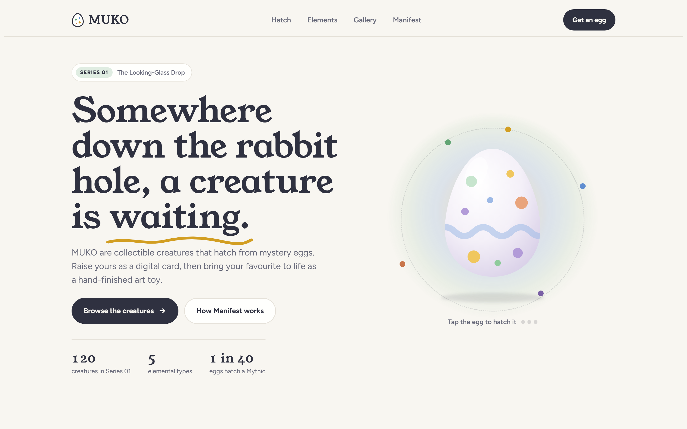
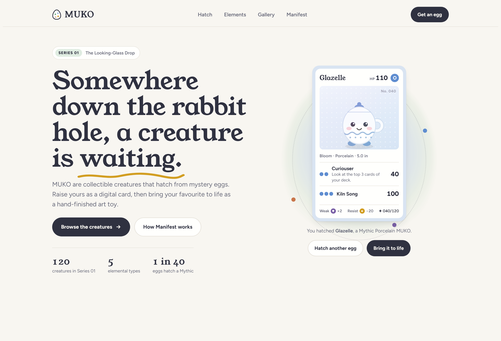
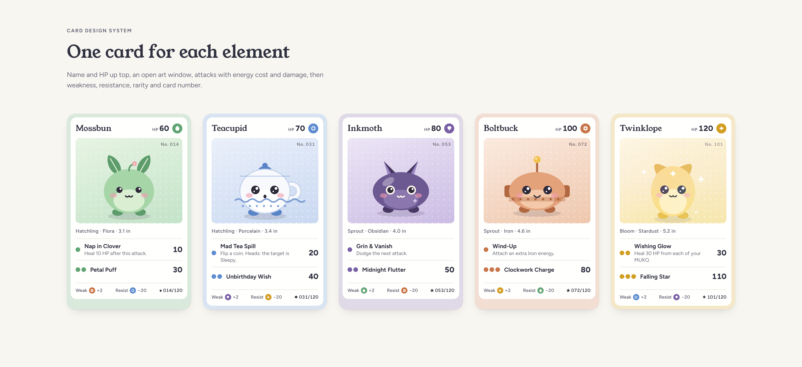
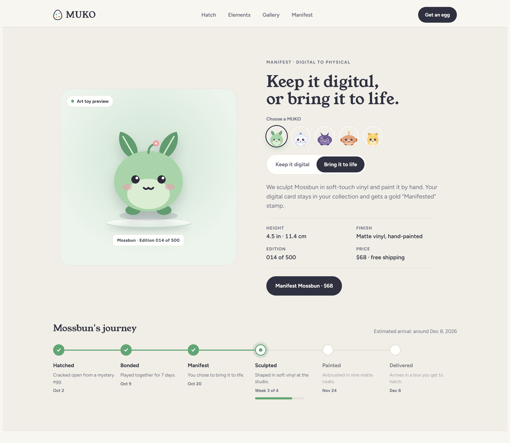
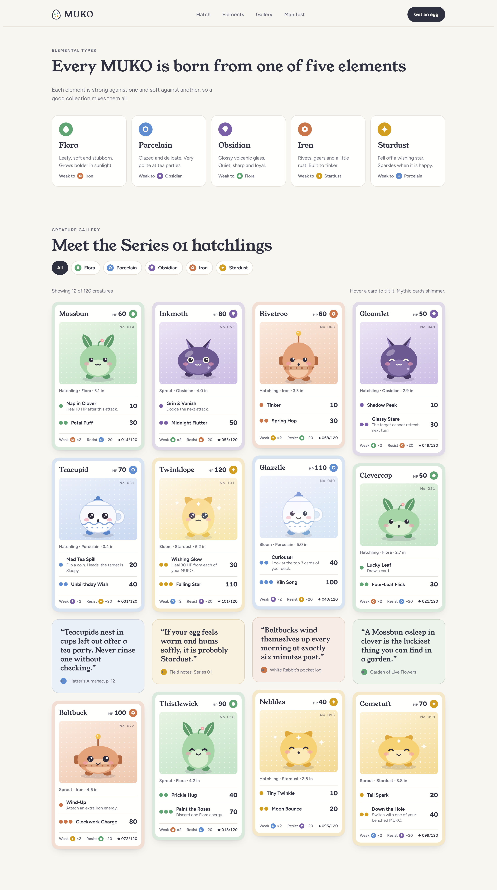
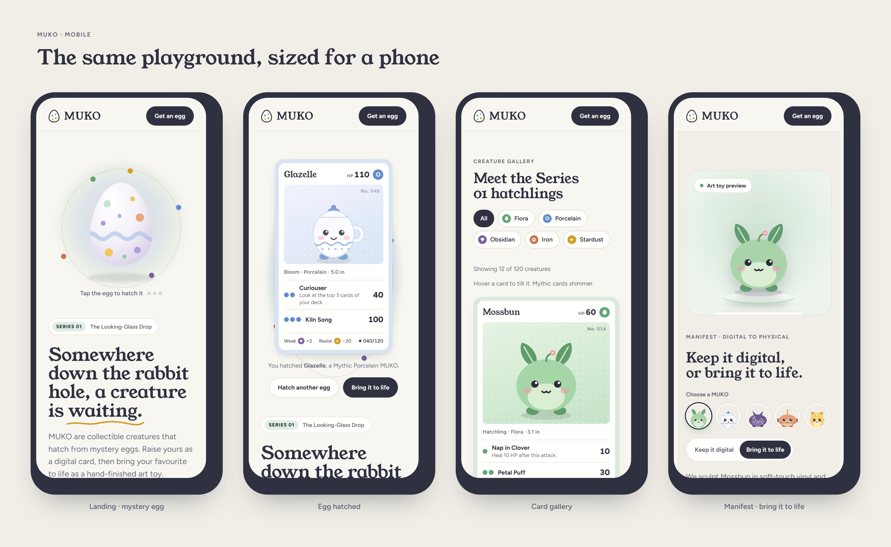

# MUKO UI

UI concept for MUKO, a whimsical collectible creature card game inspired by Alice in Wonderland.

**Live site:** https://loomastudio.github.io/muko-ui/

## Screens

| | |
|---|---|
|  |  |
|  |  |

All creatures, stats and prices are sample content.
